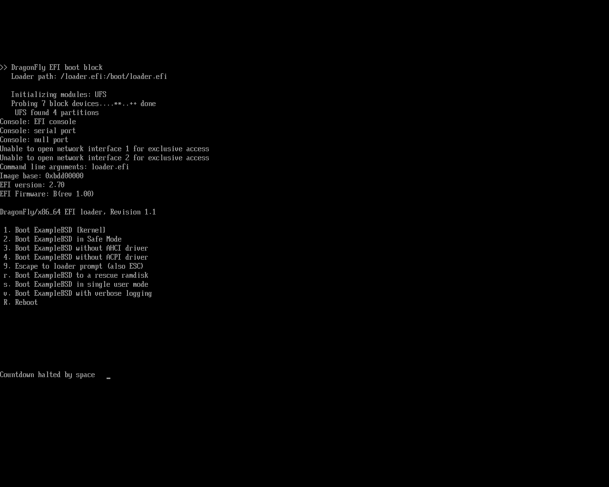
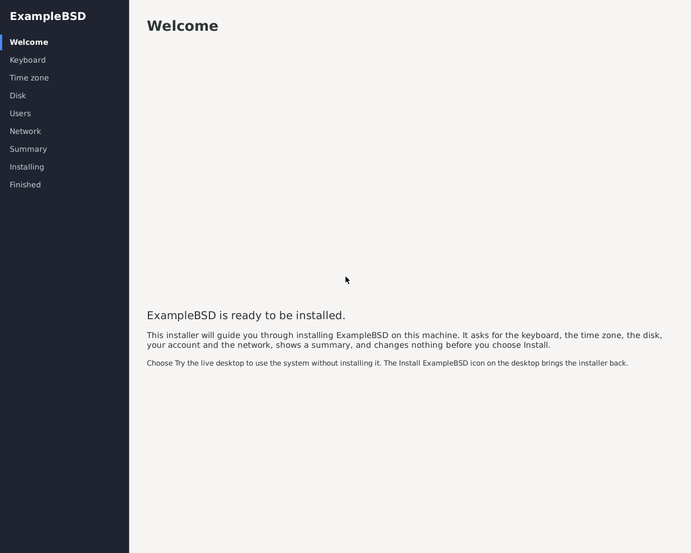
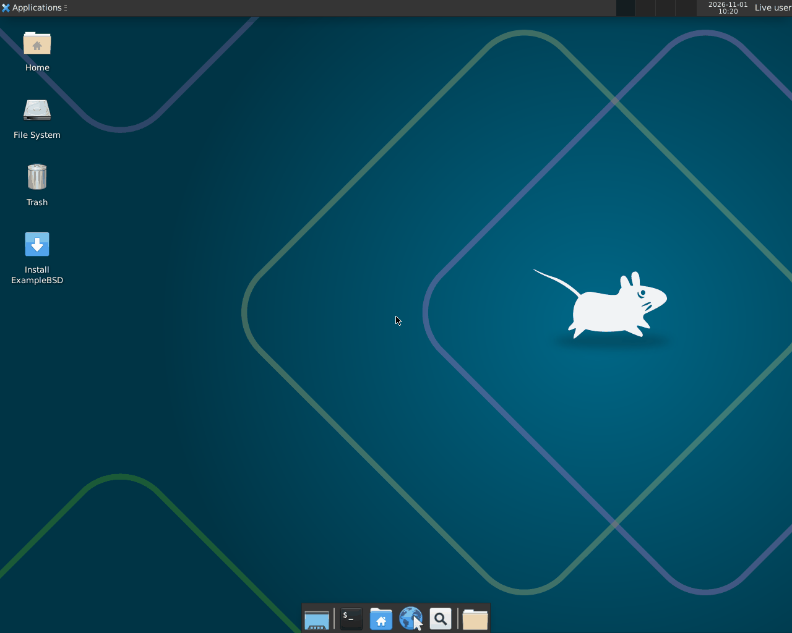
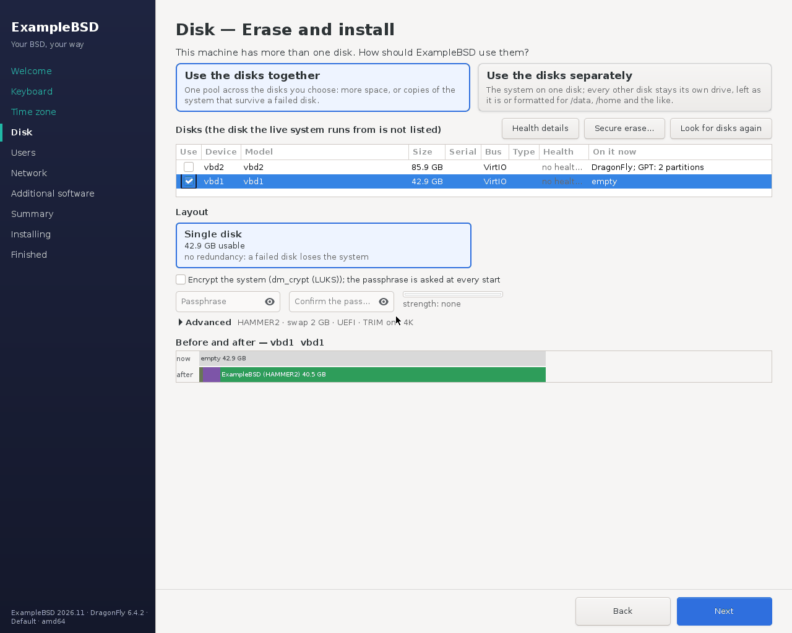
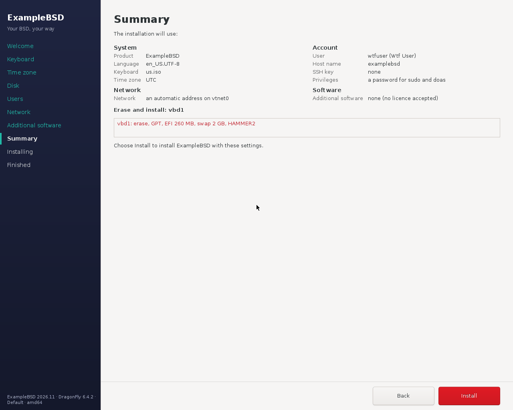
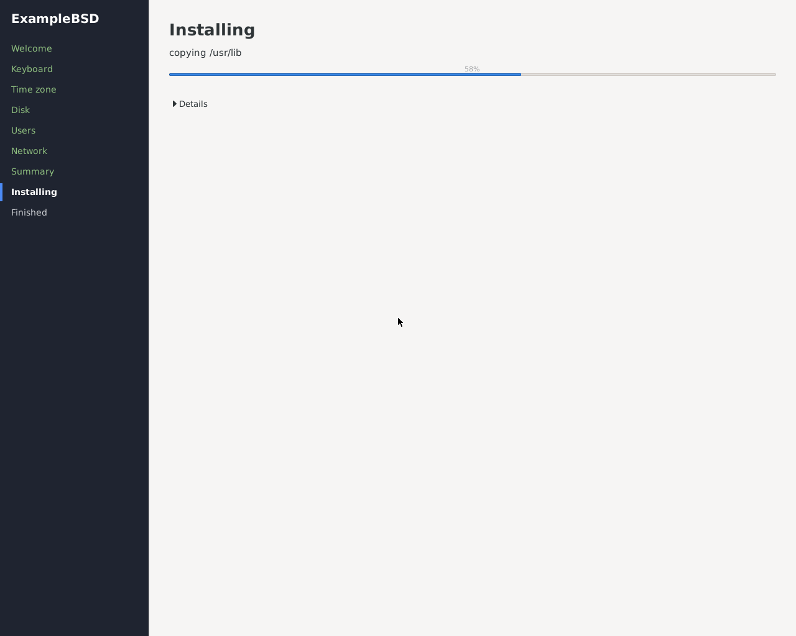
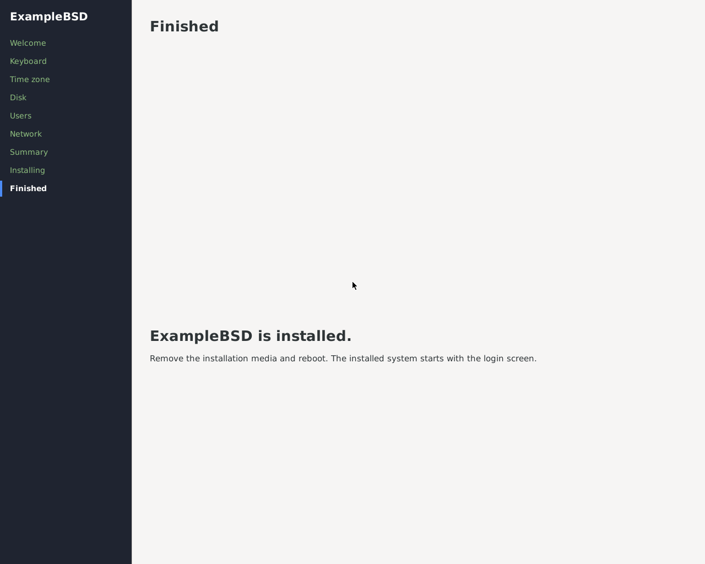
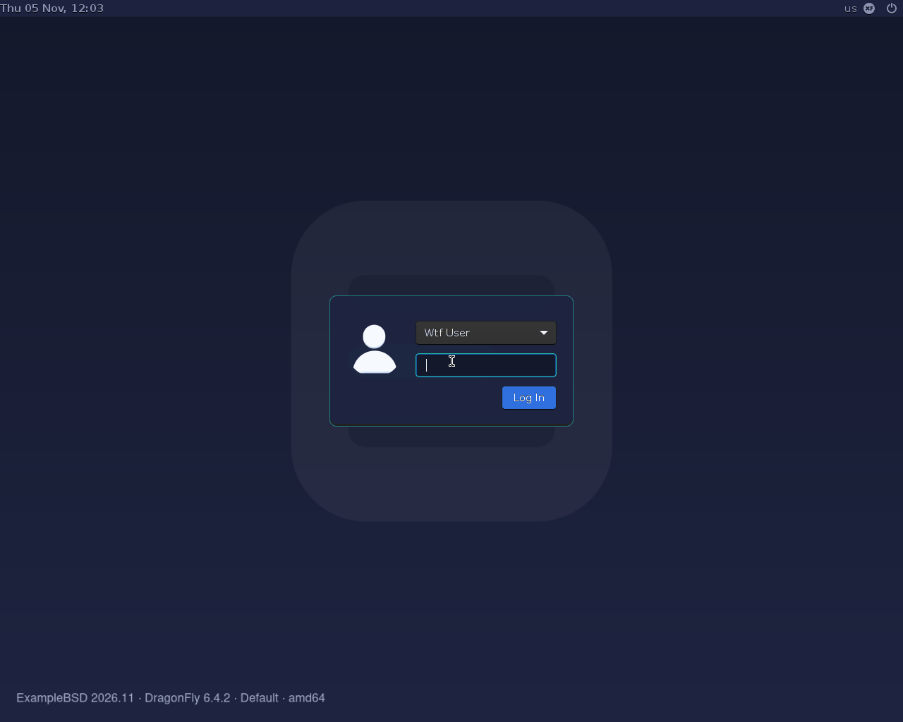
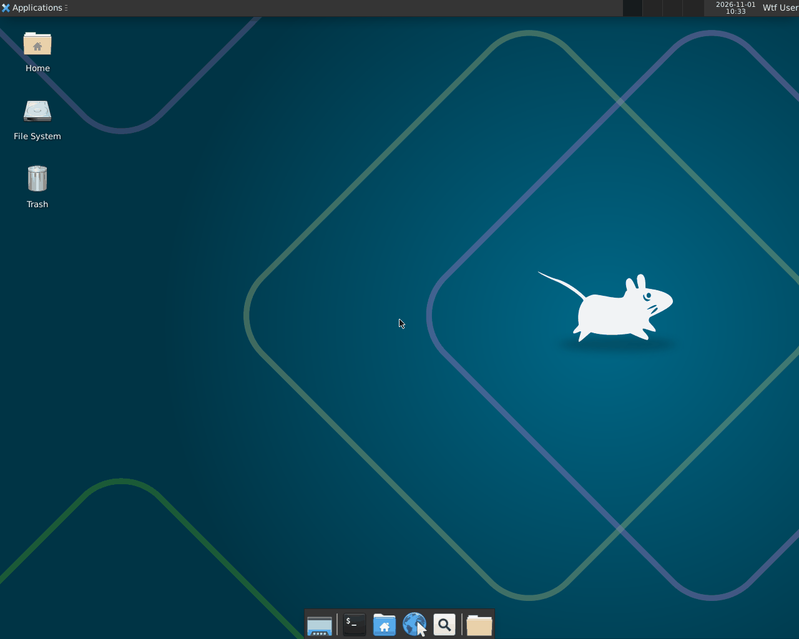

# dragonfly-template — DragonFly distribution template

A template for shipping a per-product distribution that is an **overlay on
unmodified upstream DragonFly**. Product name placeholders: **ExampleBSD**
(slug `examplebsd`), hostnames `example.org`. The template never patches
the DragonFly source tree and never patches DPorts; the media are built
with the stock release tooling, through the hooks that tooling documents:

```
make -C /usr/src/nrelease release ROOTSKELS=<the staged overlay> \
	ISODIR=<the profile> ISOROOT=<the release root> \
	ISOFILE=<the iso> IMGFILE=<the image> \
	DPORTS_EXTRA_PACKAGES="<the packages of the overlay>"
# the post-customize step in the release root, then:
make -C /usr/src/nrelease mkiso mkimg ISODIR=... ISOROOT=... \
	ISOFILE=... IMGFILE=...
```

Copyright (c) 2026 The wtfbsd contributors. BSD-2-Clause (see `LICENSE`).

## What it looks like

ExampleBSD on **DragonFly 6.4.2** (amd64): the desktop media of the
example product, booted in a virtual machine (UEFI, 1280x1024), installed
onto an empty disk with the graphical installer, and the installed system
after its first boot, with the branding of the default artwork variant:
the product's loader menu, greeter and wallpaper, and the identity line
lower left (`ExampleBSD 2026.11 · DragonFly 6.4.2 · Default · amd64`).

1. The DragonFly 6.4.2 loader of the live media.

   

2. The live desktop logs the live user in by itself and opens the
   installer first, full screen.

   

3. "Try the live desktop" closes it into Xfce; the "Install ExampleBSD"
   icon (and the menu entry) opens it again.

   

4. The disk page: the disk the live system runs from is not listed (it
   is named in `/var/run/wtfbsd-live-medium`); the empty disk is chosen.

   

5. The summary before anything is written.

   

6. Installing: the install command of the template (`examplebsd-install`)
   reports its progress.

   

7. Finished.

   

8. The installed system starts with the LightDM greeter: no live user, no
   automatic login.

   

9. The account made by the installer in its Xfce session.

   

## Layout

```
:.
├── AGENTS.md                   what this repository is, and how to work in it
├── Jenkinsfile                 CI: validate -> test -> build -> boot test -> archive
├── opencode.json               the project's agents for opencode
├── build.sh                    the build driver (POSIX sh)
├── tools/
│   └── post-customize.sh       the step that runs in the release root between
│                               the release and the media
├── ci/
│   ├── vm.sh                   the one VM front end (create/console/addr/destroy)
│   ├── validate-params.sh      the check of the parameters of the pipeline
│   └── providers/
│       └── bhyve.sh            the reference provider (stock FreeBSD bhyve(8))
├── overlay/                    THE overlay: nothing here patches /usr/src
│   ├── base/
│   │   ├── packages.list       the DPorts packages every profile gets
│   │   ├── rc.conf.d/          the rc.conf(5) variables every profile gets
│   │   │                       (hostname)
│   │   └── rootfs/             copied over the release root: etc/motd.template,
│   │                           etc/rc.d/firstboot_user,
│   │                           usr/local/etc/doas.conf,
│   │                           usr/local/sbin/@SLUG@-info
│   └── profiles/
│       ├── appliance/          headless: packages.list, rc.conf.d/sshd,
│       │                       etc/ssh/sshd_config
│       └── desktop/            X11 only: packages.list,
│                               rc.conf.d/{dbus,sshd,lightdm},
│                               etc/rc.d/live_session (the live desktop),
│                               etc/rc.d/live_medium (the live medium),
│                               usr/local/sbin/@SLUG@-install (the install
│                               command), usr/local/sbin/@SLUG@-live-clean,
│                               sysctl.conf.d/evdev, the LightDM
│                               configuration, the scfb X fallback
│                               (the software-framebuffer X driver, so X11
│                               starts on a VM or machine without a GPU driver)
├── tests/
│   ├── run-tests.sh            the checks (no root, no network, no VM)
│   ├── boot-test.sh            boots a media and waits until it is usable
│   ├── leak-check.sh           the leak check of the tree
│   ├── fixtures/fake-installer-template/
│   │                           a stand-in for install-into-stage.sh
│   ├── stubs/                  stand-ins for the tools of the build, so that
│   │                           the suite can run the real build path
│   └── fixtures/               the example product.conf, the canned serial log,
│                               the fake VM provider, the master password file,
│                               the fake source tree and the fake release root
└── .opencode/agent/            the builder and tester agents
```

## Overlay rules

- **Never patch the DragonFly source tree and never patch DPorts.**
  Configuration happens through the files under `overlay/**/rootfs/`, which
  are copied over the release root, through the `rc.conf.d/` fragments,
  and through `packages.list`, which names the DPorts packages that are
  staged into the release root.
- Overlay `rootfs` files are copied base-first, then the profile on top.
- `@DISTRO_NAME@`, `@MOTD@`, `@SLUG@`, `@BRAND_URL@` and
  `@FILESYSTEM_ROOT@` placeholders in the copied files are substituted by
  `build.sh` from `product.conf`.
- Files staged with a literal `@SLUG@` in their **name** (for example
  `usr/local/sbin/@SLUG@-info`) are renamed by `build.sh` to the slug.
- `rc.conf.d` fragments are named **after their service**
  (`rc.conf.d/sshd`, `rc.conf.d/dbus`, ...) and hold one `rc.conf(5)`
  variable per file. DragonFly's `rc.conf(5)` is a single file like
  FreeBSD's, so `build.sh` merges the fragments into the `rc.conf` of
  the release root; the fragments themselves are not shipped in the media.
- `sysctl.conf.d` fragments (base, then profile) hold `sysctl.conf(5)`
  lines (`name=value`). `build.sh` appends them, below a marker line per
  fragment, to the stock `/etc/sysctl.conf` of the live media **and** of
  the installed system (`etc.hdd`); a name already set there gets the
  new value in place. An overlay `etc/sysctl.conf` would replace the
  stock file instead. The desktop sets `kern.evdev.rcpt_mask=6` this way,
  so that keys reach Xorg through kbdmux (needed under bhyve, harmless on
  real hardware).
- `rc.conf.installed.d` fragments (base, then profile) follow the same
  rules but reach **only the installed system** (`etc.hdd/rc.conf`). Put
  there what must not run on the live media. (LightDM runs on both: on
  the live media it logs the live user in.) An image that is booted as
  the system itself (the appliance, which has no `installer` account) gets
  these fragments in its own `rc.conf` as well.
  DragonFly has no `rc_configured`, and nothing of this repository asks
  for it.
- **Every account with uid 0 is locked** in the staged image: the stock
  release leaves root, toor and operator with an **empty** password, and
  the release tooling creates an `installer` account with uid 0 and an
  empty password. `build.sh` writes `*` into the password field of every
  uid-0 account of `etc/master.passwd`, removes the `installer` account
  from the appliance image, and rebuilds the password database with
  `pwd_mkdb(8)`. The build refuses to publish a release root that holds
  a uid-0 account with a password that can be typed.
- The overlay is copied with `cp -R`, never with `cp -p`: every path of
  the overlay gets the owner and the mode of a system file (`root:wheel`,
  directories 0755, files 0644 and the scripts 0755), so that the
  checkout of the template can never leave a system directory of the
  image writable by its own owner. The paths are handled **one by one**:
  no tree of the release root is ever walked with `chown -R` or
  `chmod -R`.
- The privilege escalation is `doas(1)`: the overlay ships
  `/usr/local/etc/doas.conf` with `permit persist :wheel`, the first-boot
  user is put into the `wheel` group, and there is **no `sudo`** anywhere
  in this template.
- Any `rm -rf` in `build.sh` is guarded: only paths that are validated
  non-empty and under the output directory may be removed. Edits such as
  the `rc.conf` change are applied to the STAGED copy only — the
  upstream tree is never touched.

## The wireless driver rule

The wireless driver that this template never enables is **never mentioned,
loaded or configured** here, and `build.sh` enforces that: the build fails
if any file under `overlay/` even mentions it — which is why the overlay
contains no such mention at all. Keep it that way.

## Profiles

| profile      | what it builds |
|--------------|----------------|
| `appliance`  | headless: a serial console, `sshd` with `PermitRootLogin no` and `PasswordAuthentication no`, no extra software. |
| `desktop`    | X11 only, **no Wayland anywhere**: the X11 server (`x11/xorg`), Xfce and the LightDM greeter from DPorts, plus `dbus`. sshd is deliberately not enabled on the desktop, so the account of the operator needs a password. |

## The no-ZFS rule

**DragonFly has no ZFS at all.** The native filesystem of DragonFly is
HAMMER2, UFS is available as well, and the root of the **release image**
is UFS: the release tooling creates the image root with `newfs(8)`.
`build.sh` refuses `FILESYSTEM_ROOT=zfs` and `ZFS_DATA_POOL=yes` and
quotes the honesty note of the per_os row of `wtfbsd/agents
questions.yaml`:

> The native filesystem is HAMMER2 (UFS is also available). No ZFS.

A product therefore answers:

```
FILESYSTEM_ROOT=hammer2
ZFS_DATA_POOL=no
```

There is no data pool either: the rule is not "ZFS for data only", it is
"no ZFS". The `motd` of the product states the truth about the image: it
never claims that the root of the image is HAMMER2.

## Packages

The extra software comes from DPorts. `packages.list` holds one DPorts
**origin** per line (`category/port`); `build.sh` hands the base list and
the profile list to the release tooling, which puts them into the release
root:

```
DPORTS_EXTRA_PACKAGES="<the packages of the base list and of the profile list>"
```

The names are DPorts origins (`category/port`), which both ways of the
release tooling of DragonFly 6.4 accept. With the `binpkgs` modifier (on
by default, `BINPKGS=yes`) `nrelease` installs binary packages with
`pkg`, by name and then by origin; without it (`BINPKGS=no`) it runs
`make install` for every DPorts origin in a chroot, which builds every
package from source. A list that holds a bare name is refused by the
build.

The DPorts tree of the build host is named on the command line of the
release tooling (it is where `BINPKGS=no` builds from). Its path is
`DPORTS_PATH` and its default is `/usr/dports`; the `check` target of the
release tooling refuses to build without it:

```
DPORTS_PATH=/usr/dports ./build.sh -c product.conf
```

The DPorts mirror is configured in the build host's `pkg.conf`; the
template writes no repository file. The DPorts prefix on DragonFly is
`/usr/local`, which is where the LightDM configuration of the desktop
profile lives. The names in the `packages.list` files are plain data, so
a site can correct them in the file without touching the build; the ones
of this template were checked against the DPorts tree of DragonFly.

## First-boot user

`build.sh` **refuses** to build an image without a first-boot user: an
image without an account is an image nobody can log into. `--no-user`
builds one anyway, and the plan of the build says that nobody can log
in.

`build.sh` locks root, so every image provisions its login account on the
first boot with `overlay/base/rootfs/etc/rc.d/firstboot_user`. It
**parses** (never sources) `/boot/firstboot-user.conf` (`KEY=value`
lines):

```
USERNAME=alice        # ^[a-z_][a-z0-9_-]{0,31}$, required
FULLNAME=Alice        # no ':' / control characters, optional
SSH_KEY=ssh-ed25519 <the public key>  # one authorized_keys line, may repeat
PASSWORD_HASH=$6$...  # crypt(3), $6$, $5$ or $2b$, optional
WHEEL=yes             # yes|no, default yes
HOSTNAME=box          # the host name (rc.conf hostname), optional
TIMEZONE=Europe/Paris # a zoneinfo name (/etc/localtime), optional
KEYMAP=fr.iso         # a syscons keymap (rc.conf keymap), optional
DOAS_NOPASS=yes       # yes|no: doas without the password, default no
ROOT_PASSWORD_HASH=$6$... # root's own password, optional (root stays locked otherwise)
```

The live installer (`@SLUG@-install`, below) writes this file on the disk
it installs, with the answers of the operator.

The config is validated line by line, the user is created with
`pw useradd` (in the `wheel` group), a given hash is fed to
`pw usermod -n USER -H 0` over stdin (a locked account cannot ssh, so
without a hash the password stays `*` — key login works — and `pw lock` is
never used), the keys are installed as `~USER/.ssh/authorized_keys` (0700
dir / 0600 file, user-owned), and the config is renamed to
`/boot/firstboot-user.conf.done` (chmod 600 — it may hold a hash). A
key-only wheel user gets a `permit nopass` line in
`/usr/local/etc/doas.conf`, so that the account can become root without
typing the password of a session it never typed.

**The script guards itself:** while the configuration file is absent it
does nothing at all, so it can run at every boot. Its rc.d keyword is
**not** the `firstboot` keyword: the installer of DragonFly copies only
the paths of `share/installer/sources.conf`, and `/firstboot` is not
among them, so a script that is guarded by that keyword never runs on an
installed system. The configuration file is the guard the script relies
upon; the sentinel is removed when the provisioning is done.

**On the live media the account is not created, and the configuration
is left as it is:** the installer copies `/boot` to the installed system,
so the configuration has to reach it unchanged. The script recognises the
live media by the `installer` account that the release tooling adds to
it. The root of the `.img` live media is writable, so a writable root is
not a sign of an installed system. The installed system has no
`installer` account, and it provisions the account on its first boot and
renames the configuration to `.done`. An image that is booted as the
system itself (the appliance, from which `build.sh` removes the
`installer` account) provisions on its own first boot. A home directory
that is not writable (the cd9660 ISO) is only a fallback: every live
media built by this template carries the `installer` account, so in
practice that account is the one signal.

## Installing from the live media

The desktop media boot a **live Xfce desktop** with the graphical
installer of [installer-template](https://github.com/wtfbsd/installer-template)
open first, full screen:

- `/etc/rc.d/live_session` runs on the live media only (they carry the
  `installer` account of the release tooling; the installed system does
  not). It creates the live user `live` (the first free uid from 1100 up,
  no password that can be typed, **not** in `wheel`), copies the
  autostart entry of the installer into `~live/.config/autostart`, and
  writes `lightdm.conf.d/90-live-autologin.conf`, so that LightDM logs
  `live` in by itself (autologin) into Xfce.
- `/etc/rc.d/live_medium` runs early on the live media (after `/var/run`
  is cleaned, before the live session and the login) and writes the disk
  they were started from to `/var/run/wtfbsd-live-medium`: one line, for
  example `/dev/vbd1`. The root is mounted by its label
  (`/dev/part-by-label/<label>.a`); that devfs link is followed to its
  partition and the slice and partition are dropped. The file is written
  in `/var/run` and renamed into place (a link already there is replaced,
  never followed). The installer never offers that disk; the
  `installer.conf` of the live media sets `LIVE_MEDIUM_REQUIRED=yes`
  (installer-template README, "The live medium").
- The installer opens first. "Try the live desktop" closes it into the
  normal Xfce session; the "Install <product>" icon on the desktop and the
  entry in the menu open it again.
- The front ends of the installer (GTK and text) run as `live`, never as
  root. The live `doas.conf` gets exactly one rule for `live`, for the
  GTK-free root helper of the installer:
  `permit nopass live as root cmd /usr/local/libexec/wtfbsd-installer/installer-apply`
  (no `keepenv`, no `setenv`).
- The helper runs the install command of this template,
  `/usr/local/sbin/@SLUG@-install` (below).
- The installed system has **no** live user, **no** autologin and **no**
  installer: LightDM shows the greeter. `@SLUG@-live-clean` removes all
  of it from the copy (every path of the installer's MANIFEST, and the
  `__pycache__` of `.pyc` files Python leaves in its directories), and
  runs again at every boot of a system that is not the live media.

The fallback is the stock DragonFly installer, on `ttyv1` (the live media
get a getty there; LightDM owns the display on `ttyv0` and up) and on the
serial line (`ttyd0`). Log in as `installer`, with no password, to start
it. It runs `/usr/local/bin/after_installation_routines.sh` after its
copy, which removes the live session from the installed system as well.

Things a forker should expect from the stock installer:

- its screens say "DragonFly BSD", not the name of your product. The
  installer is part of the base system, and this template does not patch
  it;
- "Reboot this Computer" halts the machine rather than rebooting it.
  Press a key on the console, or power-cycle the VM or machine, to boot
  the installed system.

### Branding (ARTWORK_REF, ARTWORK_VARIANT, the identity line)

The desktop takes its look from the artwork template, pinned like the
installer: `ARTWORK_REF` (product.conf; default the merged main of
artwork-template, `5aaea01b...`) and `ARTWORK_VARIANT` (`default`,
`cyberpunk`, ...). The build uses the **pre-rendered pack** of that commit
and variant (`scripts/pack.sh` of the template), so the build host renders
nothing and needs only ImageMagick to stamp the identity line:

- by default it downloads `<slug>-<commit 12>-<variant>.tar.xz` from the
  releases of artwork-template (`ARTWORK_PACK_URL`) and refuses it unless
  it matches the checksum pinned in `tools/artwork-packs.sha256`, or
  `ARTWORK_SHA256` of product.conf when it is set (a product's own
  artwork, or another commit than the pinned one);
- `ARTWORK_PACK=<pack.tar.xz>` (with its `.sha256` next to it) uses a pack
  you made, for example for a product with its own name (rebrand the
  template, then `scripts/pack.sh`);
- `ARTWORK_DIR=<checkout>` renders a checkout of the template instead
  (rsvg-convert, inkscape or cairosvg, and ImageMagick).

The pack must have been made from `ARTWORK_REF`, for the variant and for
the slug of the product. After the release, `tools/brand-stage.sh` writes
into the release root:

- `/usr/local/share/<slug>/identity`, in the format of the artwork
  template (its `scripts/identity-file.sh` writes it when it has one):
  `PRODUCT`, `VERSION` (`PRODUCT_VERSION` in product.conf, default the
  year.month of the build, for example `2026.11`), `BASE` (read from the
  built kernel, for example `DragonFly 6.4.2`, never typed in), `VARIANT`
  (the label of the variant), `ARCH` and `BUILD` (the build date when the
  version is not numbers and dots, a test build; empty otherwise);
- the identity line `<Product> <version> · DragonFly <release> · <variant>
  · <arch>` small and lower left on the greeter background and the
  wallpapers: the template stamps it when its `render.sh` takes
  `--identity`, otherwise it is stamped into the SVG sources before the
  render;
- every branding spot the template's `branding/spots.tsv` marks supported
  on DragonFly (its `dragonfly` column is neither `n/a: ...` nor
  `check: ...`; the columns are read by header name and a missing one
  stops the build), each by the DragonFly way of installing it: the loader
  menu, the motd and the login banner (`gettytab` `im=`, `/etc/issue`) of
  the live media and of the installed system, the LightDM GTK greeter
  background, configuration and theme, the xdm logo and colours, the
  installer header, sidebar and palette, the wallpapers and the Xfce
  defaults of new users (`/usr/local/etc/xdg/xfce4/xfconf/xfce-perchannel-xml`),
  the distributor, menu and installer icons in every size, and the xfwm4
  colours; the wallpaper session helper of the artwork, root-owned 0755
  as `/usr/local/share/<slug>/xfce/session/<slug>-wallpaper.sh`, and its
  autostart entry `/etc/xdg/autostart/<slug>-wallpaper.desktop` (live
  media and installed system; its `Exec=` line is written by the build to
  name that helper), which puts the wallpaper on every display output that
  has none yet. A spot marked supported that this template has no way to
  install, or whose file is not in the pack, stops the build.
- The DragonFly loader has no image splash (its ASCII art is compiled in):
  its branding is the menu, `/boot/dloader.menu` (the stock
  `/boot/defaults/dloader.menu` with the titles of the template, "Boot
  ExampleBSD ..."), and `fred_disable="YES"` in `/boot/loader.conf` hides
  the ASCII dragonfly; the install command keeps both.

The build host needs ImageMagick (`pkg install ImageMagick7-nox11`) to stamp
the identity line, and `fetch(1)` or curl for the download.

### The installer of the live desktop (INSTALLER_REF)

`build.sh` takes installer-template at a pinned commit or tag,
`INSTALLER_REF` in `product.conf` (empty: the commit this template pins),
cloned with `git` from `INSTALLER_URL` in `product.conf` (https only;
empty: the public repository; `INSTALLER_REPO` in the environment wins),
or from a local checkout, `INSTALLER_DIR` in the environment, which wins.
It runs `install-into-stage.sh <staged overlay> --conf <installer.conf>
--artwork <the unpacked pack>` (the product name, the slug,
`OS=dragonfly`, keymap `us.iso`, time zone UTC; `--metalog` when built
without root). With `--artwork` the script runs `python3` on the build
host (`pkg install lang/python3`).

The six product.conf keys of the live media (wtfbsd/agents
`questions.yaml`) all read an empty value as "not set": `INSTALLER_REF`,
`INSTALLER_URL`, `PRODUCT_VERSION`, `ARTWORK_VARIANT`, `ARTWORK_REF` and
`ARTWORK_SHA256` then take the template's pin or default.
The desktop is refused without either. The desktop packages add
`lang/python3`, `devel/py-pygobject` (PyGObject), `x11-toolkits/gtk30`,
`x11/xterm` and `devel/bsddialog`.

### The install command: `@SLUG@-install`

```
@SLUG@-install -p PLANFILE | -d DISK  -u USER -H HASHFILE [-c FULLNAME] [-P] [-A]
               [-k PUBKEYFILE] [-n HOSTNAME] [-z TIMEZONE] [-Z utc|local]
               [-K KEYMAP] [-L LOCALE] [-r locked|ROOTHASHFILE] [-E PASSPHRASEFILE]
               [-N IF:dhcp|IF:ADDR/MASK:GW]... [-6 IF:slaac|IF:ADDR6/LEN:GW6]...
               [-D DNS]... [-W WIFIFILE] [-U] [-l ACCEPTFILE] -y [--progress]
@SLUG@-install --capabilities
```

- `-p` the disk plan of the installer (JSON, version 1, mode 0600). On
  DragonFly: mode `erase`, UEFI, layout `single` on one disk, filesystem
  `hammer2` or `ufs`, `encryption` of the root with
  dm_crypt (LUKS) (the swap is not encrypted: not yet proven on DragonFly), `swap_mb` (0: no swap), `wipe` `quick` or `secure`
  (the whole disk overwritten with zeros), `usage` `together` or
  `separate`, and `data` volumes: each one whole other disk (layout
  `single`, `hammer2` or `ufs`) mounted at its mount point from fstab by
  its own label (`/dev/part-by-label/<slug>-<name>-<8 hex>.a`). An
  encrypted install takes no data volumes (DragonFly encrypts the system
  disk only). Anything else is refused with the reason. `-d DISK` is the
  plan that erases DISK with the defaults; a bare disk name (`vbd0`,
  `da0`), never a path.
- `--capabilities` prints what the command installs, one JSON object in
  the shape of the installer-template adapter hook `os_layouts`
  (`layouts`, `filesystems`, `modes`, `data_pools`, `boot`: `["uefi"]`,
  `encryption`, `not_offered`), and changes nothing. The installer's
  adapter asks the installed command first, so its Disk page offers only
  this (UEFI shown as fixed text, no BIOS).
- The disk of the running system (the live media) and every disk with a
  mounted file system or swap is refused, also when it is mounted through
  an alias (`part-by-label`).
- `-H` a file of mode 0600 with the `$6$` hash of the password (DragonFly
  `crypt(3)` takes SHA-512 crypt); the password never reaches the command.
  `-r FILE` the same for root (otherwise root stays locked).
- `-E` the passphrase of the encryption: one line, 8 to 1024 bytes, mode
  0600. It is used without its end of line (the passphrase typed at boot
  has none), from a copy in a directory of root that is removed after.
  The encrypted root boots through the initrd of DragonFly
  (`vfs.root.realroot="crypt:..."`), as the stock installer does it.
- `-K` a syscons keymap: the consoles get it at the first boot, and X gets
  the matching layout (`xorg.conf.d/00-keyboard.conf`). `-L` the locale
  (the default class of `login.conf`), `-Z local` a hardware clock on
  local time (`/etc/wall_cmos_clock`).
- `-N` IPv4 per adapter, `-6` IPv6 (SLAAC or static), `-D` resolvers
  (`resolv.conf` and `resolv.conf.head`), `-W` a Wi-Fi network (a JSON file
  of mode 0600, written to `wpa_supplicant.conf` with the SSID and the PSK
  as hex; WPA3 uses SAE). Without `-N` every wired adapter asks DHCP.
- `-A` LightDM logs the user in by itself on the installed system (off by
  default). `-P` doas without the password. `-U` updates the packages of
  the installed system with `pkg` (a failure is reported, the system stays
  installed).
- `--progress` prints `PROGRESS <0-100> <message>` and `ERROR <message>`
  on stdout and nothing else; the commands write into a log that goes to
  `/var/log/` of the installed system (the file is named after the
  command). No secret reaches the log.

- `-l` the licensed software the user accepted on the Additional
  software page (JSON of mode 0600: id, licence, sha256 of the licence
  text, timestamp). Every id is checked against the catalogue of the
  media, `/usr/local/share/@SLUG@/licensed-software.json`; only those
  items are installed (`pkg`), and the file is kept as
  `/var/db/@SLUG@/licenses-accepted.json`. Nothing is accepted
  implicitly. The default set of this template needs no acceptance (X11,
  Mesa, the GPU and video drivers, Xfce and LightDM are redistributable
  with their notices), so the catalogue ships empty: a product adds its
  items (id, name, description, size_mb, licence id and text path (an
  absolute path on the media), the flags non_commercial / vendor_key /
  vendor_download / needs_network, install method `pkg` and the package
  names). The catalogue is also the list of the Additional software page
  of the installer, whose `lib/licensed.py` (installer-template) reads it
  strictly: the top-level keys are `version` (1), `items` (a list) and
  `notices` only, and any other key makes it refuse the whole catalogue,
  so a remark about the catalogue goes here, never into the file.
  `notices` is optional: when it is there, it is the relative path of a
  text file under the directory of the catalogue (letters, digits, `.`,
  `_`, `-` and `/`; `"notices": "notices.txt"`), whose
  text the "Open-source licences" link of the page shows.

It writes the layout of the stock installer for UEFI and HAMMER2: GPT
with a 128 MiB EFI partition (the loader as `EFI/BOOT/BOOTX64.EFI`) and a
DragonFly partition with a `disklabel64` of `/boot` (1 GiB UFS), swap
(by default twice the memory, at most a tenth of the disk) and `/`
(HAMMER2 or UFS, the rest); `/build` holds the null mounts of `/usr/obj` and `/var/{crash,
cache,spool,log,tmp}`. The system is **the live root itself, copied** the
way the stock installer copies it (the paths of
`/usr/share/installer/sources.conf`, `X.hdd` in place of `X`): no second
image of the system on the media, the file systems fill the disk as they
are made (nothing has to grow), and the result is the installed system
the stock installer makes. Then it removes the live session and every
path of the installer's `MANIFEST` from the copy, writes `loader.conf`,
`fstab`, the network and `/boot/firstboot-user.conf`, and exits 0 only
when the EFI loader, the kernel and the root of the loader are in place.
The DragonFly label of the disk gets a name of its own (the slug and 8
random hex digits, for example `examplebsd-a60a411d`); devfs names its
partitions `/dev/part-by-label/<name>.a`, `.b` and `.d`, and `fstab`, the
loader (`vfs.root.mountfrom="hammer2:part-by-label/<name>.d"`),
`crypttab` and `dumpdev` use those names. The installed system therefore
boots whatever the disk is called on the next boot (installed as `vbd1`,
booted alone as `vbd0`), unlike the device names the stock installer
writes.

For CI and test images, `build.sh` bakes the same configuration in:

```sh
./build.sh -c product.conf -u ciuser -k ./id_ed25519.pub   # a key
./build.sh -c product.conf -u ciuser -P ./passwd.hash      # a password
```

`-P` takes a file with **one `crypt(3)` hash** (`$6$`, `$5$` or `$2b$`); a
plain text password is refused, because it would end up in the image and
in the transcript of the build. The appliance profile **needs** a key
(`-k`): it is the way in over ssh. The desktop profile **needs** a
password (`-P`): it has no sshd, so a key is of no use there.

## Building

`product.conf` is produced by the answers script of the template set; its
keys are the question ids of the questions file. `build.sh` parses it
line by line and never sources it.

```sh
./build.sh -c product.conf -n                 # dry run: print the plan
./build.sh -c product.conf                    # the profile of product.conf
./build.sh -c product.conf -p both            # appliance + desktop
./build.sh -c product.conf -s /path/to/src    # another DragonFly source tree
./build.sh -c product.conf -u ciuser -k ./ci.pub   # bake a first-boot user
./build.sh -c product.conf -u ciuser -P ./passwd.hash  # ... with a password
./build.sh -c product.conf --no-user          # ... and nobody can log in
```

The build needs the DPorts tree of the build host (`DPORTS_PATH`, by
default `/usr/dports`): with `BINPKGS=no` the packages of the overlay
are built from it, and the `check` target of the release tooling refuses
to build without it.

The dry run validates the configuration, prints the whole plan and
changes nothing. It works on any POSIX host. The plan is not a second
copy of the build: every command of the build goes through the `step()`
helper, so the dry run prints the very commands the real path runs (the
test suite compares the two). A dry run never refuses an image that the
real build would refuse to make: it says so in the plan and goes on. A
plan without a first-boot user therefore carries the line

```
  login    WARNING: no first-boot user given (the real build needs -u or --no-user)
```

and the real build refuses to make such an image.

The real build needs an unmodified DragonFly source tree (with its
`nrelease` directory) and **runs on DragonFly itself**: DragonFly cannot
be cross-built, so `build.sh` refuses the real build on any other host
and says so. The real build also **runs as root**: it writes into the
release root, installs packages and changes the owner of the staged
files.

Environment knobs of the build:

| knob | what it does |
|------|--------------|
| `DFLY_MEDIA` | `img` (default) or `iso`: the media of the desktop profile. The DragonFly 6.4 EFI loader cannot read past 2 GiB of an ISO9660 image, so the desktop ships a disk image unless `iso` is asked for (the plan then warns that the ISO must stay under 2 GiB). The appliance always ships a disk image. Any other value is refused. |
| `BINPKGS` | `yes` (default) or `no`. `yes` hands the `binpkgs` modifier to `nrelease`, which installs binary packages with `pkg`; `no` builds every package from its DPorts origin with `make install` in a chroot (hours). Any other value is refused. |
| `DPORTS_PATH` | the DPorts tree of the build host (default `/usr/dports`) |

Two environment variables exist for the test suite only; a build host
must never set them:

| knob | what it does |
|------|--------------|
| `WTFBSD_TEST_ALLOW_ANY_OS` | do not require `uname -s` to be DragonFly |
| `WTFBSD_TEST_ALLOW_NONROOT` | do not require the build to run as root |

The release tooling of DragonFly is driven through the hooks it
documents, so there is no knob for the directories of the run:
`ISODIR`, `ISOROOT`, `ROOTSKELS`, `ISOFILE`, `IMGFILE` and
`DPORTS_EXTRA_PACKAGES` are the names of the upstream `nrelease/Makefile`.

Artifacts:

```
out/<profile>/<slug>-<profile>-<arch>.img    the media (.img; .iso for a
                                             desktop with DFLY_MEDIA=iso)
out/<profile>/ARTIFACT                       the path of the media
out/SHA256                                    its checksum
```

### How the overlay reaches the media

The overlay is staged into `out/<profile>/rootskels` and handed to the
release tooling as `ROOTSKELS`: the tooling copies it over the **release
root** before it builds the media, so the product is part of the media
itself and not a tarball the operator has to unpack after the
installation. Each profile has its own release root, so the appliance
overlay never leaks into the desktop media. The media are named by the
build itself (`ISOFILE=`, `IMGFILE=`), never looked for with a glob.

A `ROOTSKELS` on the command line **replaces** every default of the
Makefile of the release tooling (upstream sets
`REQ_ROOTSKELS=${.CURDIR}/root`, `ROOTSKELS?=${REQ_ROOTSKELS}` and adds
`${.CURDIR}/gui` under the `gui` modifier). The build therefore hands
over the skeleton of the release tooling, the skeleton of the GUI (the
desktop) and the overlay of the product, in that order — each one
overwrites the last:

```
ROOTSKELS="<src>/nrelease/root <src>/nrelease/gui <out>/<profile>/rootskels"
```

The **`gui` modifier is not used**: under it the release tooling adds a
browser and an editor to the packages of the release, and the product
names its own packages. The skeleton of the GUI is named in `ROOTSKELS`
instead.

The **world is built once** for the whole build: the release root of
every profile is staged from it. The **media are built once** as well,
and only after the post-customize step: a media that is built before the
release root is fixed would hold the product without the fixes.

### The post-customize step

Between the release and the media, `build.sh` runs
`tools/post-customize.sh` in the release root. It does what the release
tooling cannot know about:

- it merges the `rc.conf(5)` variables of the overlay into the `rc.conf`
  of the release root and into the `rc.conf` of the installed system
  (the overlay owns the variables, the release tooling owns the files);
- it enables the getty of the serial console (`ttyd0`) — only the status
  field of the line changes, the terminal type stays as the release
  tooling wrote it; in the `ttys` of the installed system
  (`etc.hdd/ttys`) the `ifconsole` flag is dropped as well, because the
  installer writes a `loader.conf` without the console line, while the
  live media keep it — and points the console of the kernel at it
  (`console="comconsole"` in `/boot/loader.conf`, the file the loader of
  DragonFly reads; the file of the release tooling is never replaced);
- it locks every account with uid 0 and removes the `installer` account
  of the release tooling from the appliance image. On the **desktop
  media** (a disk image by default, an ISO only with `DFLY_MEDIA=iso`)
  the `installer` account keeps its empty password: it is the install
  path, and nobody can install the system without it;
- it mirrors the `/etc` files of the overlay into `/etc.hdd`: the release
  tooling snapshots `/etc` into `/etc.hdd` **before** the rootskels are
  applied, and the installer copies `<dir>.hdd` in place of `<dir>`, so
  the `/etc` of the overlay has to be in both trees to reach the
  installed system. The `fstab` of the live media (which mounts `/etc`,
  `/var`, `/tmp` and `/root` on a tmpfs) never reaches the installed
  system, and every uid-0 account of the tree of the installer is
  locked;
- it does not create the sentinel of the first boot (`/firstboot`): the
  `mkimg` target of the release tooling creates it in the disk image, and
  the release root also becomes the read-only ISO, where the stock
  `/etc/rc` could not remove it.

## CI

The `Jenkinsfile` is generic: no organisation names, no host names, no
credentials by value. Parameters:

| parameter | default | what it does |
|-----------|---------|--------------|
| `AGENT_LABEL` | `bsd-builder` | the Jenkins agent that runs the pipeline |
| `PROFILE` | `desktop`, `appliance`, `both` | which profile(s) to build |
| `BUILD_ON_AGENT` | `false` | build on the agent instead of in a build VM |
| `PRODUCT_CONF` | — | the product configuration, uploaded as a **stashed file** |
| `VM_PROVIDER` | `bhyve` | the VM provider used for the build VM and the boot test |
| `BUILD_VM_NAME` | `wtfbsd-build` | the name of the build VM (the job name and the build number are added) |
| `BUILD_VM_IMAGE` | empty | the DragonFly disk image the build VM boots |
| `BUILD_VM_WORKDIR` | `wtfbsd-dragonfly-template` | where the repository lives inside the build VM |

`PRODUCT_CONF` is a **stashed file parameter** and needs the **File
Parameter plugin** on the controller: a file parameter of a pipeline does
not land in the workspace on its own (JENKINS-27413), so the pipeline
stashes it (`stashedFile(name: 'PRODUCT_CONF')`), unstashes it again and
copies it to `product.conf`, which is the path every later stage uses.
The Validate stage checks every free-text parameter against
`^[A-Za-z0-9._/-]+$` (`ci/validate-params.sh`): a parameter ends up in a
file name, in a directory name, in a VM name or in a command line. The
known hosts file of the workspace is emptied for every build, and only
the artifacts and the checksum come back from the build VM: the release
root of a profile is never copied out of it.

Stages: **Validate params** (checks the parameters and runs the dry run),
**Test** (the suite of the template), **Build** (in a build VM, or on the
agent), **Boot test** (one `tests/boot-test.sh` per profile), **Archive**
(`out/**/*.img`, `out/**/*.iso` and `out/SHA256`).

Every VM that is created is written into the file `.vm/vmlist` **before**
it is created, and the `post` block destroys every name of that list: a
VM that was created and not destroyed is destroyed anyway. The build VM
is destroyed at the end of the build stage as well, so that it does not
hold memory while the boot test runs. The list is emptied at the start of
every build. The name of the build VM and the name of the boot test VM
carry the name of the job and the number of the build, so that two
builds never fight for the same VM.

Because DragonFly cannot be cross-built, the build VM image is a
DragonFly system with an unmodified source tree in `/usr/src`.

The build in the build VM runs as **root**: `build.sh` refuses to build
anything else. The account of the CI in the image of `BUILD_VM_IMAGE` is
therefore root, or it has a `doas(1)` rule that needs no password for
`build.sh`. The pipeline runs the build with `doas` when the account is
not root, and with the account itself when it is.

### VM providers

Every VM operation goes through `ci/vm.sh`, which dispatches on
`WTFBSD_VM_PROVIDER`:

```sh
ci/vm.sh create NAME IMAGE   # boot IMAGE as a VM called NAME
ci/vm.sh console NAME        # print the path of the serial console log
ci/vm.sh addr NAME           # print the address of the guest
ci/vm.sh destroy NAME        # stop the VM and remove its runtime state
```

The provider script is `ci/providers/<provider>.sh` from this repository.
A site with its own hypervisor points `WTFBSD_VM_PROVIDER_PATH` at a
provider script **outside** this repository; that file then replaces the
shipped one and receives the same subcommand and the same arguments:

```sh
WTFBSD_VM_PROVIDER=mysite WTFBSD_VM_PROVIDER_PATH=/opt/ci/my-provider.sh \
	ci/vm.sh create build-1 disk.img
```

An unknown provider, a missing `WTFBSD_VM_PROVIDER` and a missing provider
script all fail closed with a message on stderr.

**The provider script runs with the rights of the agent.** It is the
agent that boots the VM, and on a FreeBSD agent that means root. A
provider script of a site therefore has to be **root-owned** and **not
writable by anyone else** — in particular not by the people who may
start a job. A provider script that a job author can change is a way
into the agent.

The shipped reference provider is `ci/providers/bhyve.sh`: stock FreeBSD
`bhyve(8)` and `bhyvectl(8)` with the serial console logged through a
`nmdm(4)` device. It needs root on a FreeBSD host and these tools
there: `bhyve`, `bhyvectl`, `arp`, plus the base system (`stty`, `cat`,
`ifconfig`). `bhyve(8)` is part of the base system; the UEFI firmware
comes from the **`edk2-bhyve`** package, which installs
`/usr/local/share/uefi-firmware/BHYVE_UEFI.fd`.

The host setup:

```sh
# the bridge of the CI network
ifconfig bridge0 create
ifconfig bridge0 up
# the tap device of a job is attached to the bridge by the provider
# itself, and the member is removed again when the VM is destroyed
```

The serial console is a **null-modem pair**: `/dev/nmdmNA` is the side
`bhyve(8)` writes to, `/dev/nmdmNB` is the side the reader reads from.
The reader puts its end of the device in raw mode: the device opens in
canonical mode with echo, the prompt of `getty` has no newline (a
canonical read would never return it) and the echo of the terminal would
feed the output of the guest back to it as input.

The devices of two VMs never collide: the unit of the null-modem pair and
of the tap device follows the executor number **and** the slot of the VM
in its job, so two VMs of one job and two jobs of one agent never share a
device. The provider stops the reader of a previous run of the same VM
before it starts a new one.

The artifact is attached as it is: an `.iso` is a CD-ROM of the guest
(`ahci-cd`), every other artifact is a disk of the guest (`virtio-blk`).
The tap device is created and brought up **before** it is attached to the
bridge, and every step that fails is fatal: a guest without a network is
of no use to the pipeline. The tap device is created and brought up even
when the host has no bridge (`WTFBSD_BHYVE_BRIDGE` is empty): `bhyve(8)`
always wants a tap device of its own, and the device is attached to a
bridge only when there is one. The provider waits for the device of the
VM under `/dev/vmm` and reports a guest that does not start.

### The boot test

```sh
tests/boot-test.sh out/appliance/examplebsd-appliance-amd64.iso appliance
tests/boot-test.sh out/appliance/examplebsd-appliance-amd64.iso appliance my-vm
```

It uses `ci/vm.sh` only, waits (600 seconds by default) for a `login:`
prompt on the serial console and, for the appliance profile, for `sshd`
to answer on port 22 (the probe is bounded: `nc -z -w 2`). It exits
non-zero on a timeout and always destroys the VM — also when it is
killed, and it reports a VM it could not destroy on stderr instead of
hiding it. `WTFBSD_BOOT_TIMEOUT` and `WTFBSD_BOOT_SSH_PORT` change the
timeout and the probed port; the name of the VM is the third argument
(or `WTFBSD_VM_NAME`), and it defaults to `boot-<profile>-<pid>`.

## Running the tests

```sh
sh tests/run-tests.sh
```

The suite needs no root, no network and no VM: it runs the dry run of
`build.sh`, runs the **real** build path against the stand-ins in
`tests/stubs` (a fake source tree with a fake `nrelease/Makefile`, a
fake release root and stand-ins for `make`, `pkg`, `tar`, `pwd_mkdb`,
`makefs`, `passwd`, `chown` and `chmod`), checks the tree statically and
runs the boot test against the fake provider in `tests/fixtures` (a
script that publishes a canned serial log). Every case is reported as
`PASS` or `FAIL`; the exit status is non-zero when a case failed.

The stand-ins refuse an option that the man page of the tool does not
know, so a build that asks `chmod(1)` or `make(1)` for something that
does not exist fails the test instead of passing it. The cases assert
**behaviour**, not the words of the fix: the first-boot script really
runs (against a stand-in for `rc.subr` that dispatches), the provider
really asks `ifconfig(8)` and `bhyve(8)` for what it needs (the
stand-ins only log their arguments), and the dry run of the build is
compared with the commands of the real build.

The suite also runs the leak check (`tests/leak-check.sh`): no file of
this repository may hold an address, an email address of another domain,
an internal top level domain (including the `home.arpa` one), a
credential shape or a token. The binary files are read as well. The
check looks for **generic shapes only** — the repository ships no list of
names, because a list of names is itself a list of names. A site that
wants to check for its own names points `WTFBSD_DENYLIST` at a file
**outside** this repository: every non-comment line of that file is a
case-insensitive extended regular expression that is matched against
every file of the tree.

## The generic-template rule

This repository is a **public, generic template**: anyone may fork it and
run it on their own Jenkins.

- No organisation-specific names anywhere: no company or project names
  other than `wtfbsd` and `ExampleBSD`, no real host names, no real
  addresses, no internal service names, no ticket numbers, no user names
  and no credential values. Credentials are referenced by a documented
  generic id only.
- The CI and the tests are generic: the VM handling goes through the one
  pluggable script `ci/vm.sh`, and a site plugs in its own provider with
  `WTFBSD_VM_PROVIDER_PATH`.
- The product is a placeholder: `ExampleBSD`, `examplebsd`,
  `example.org`. Replace them through `product.conf`.
